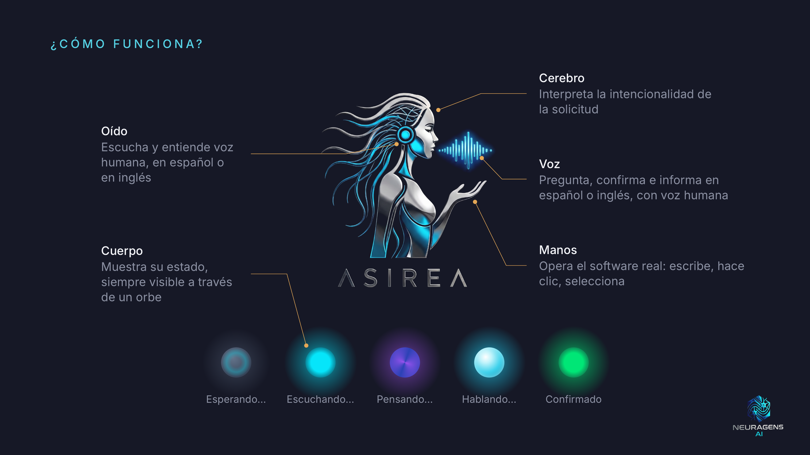
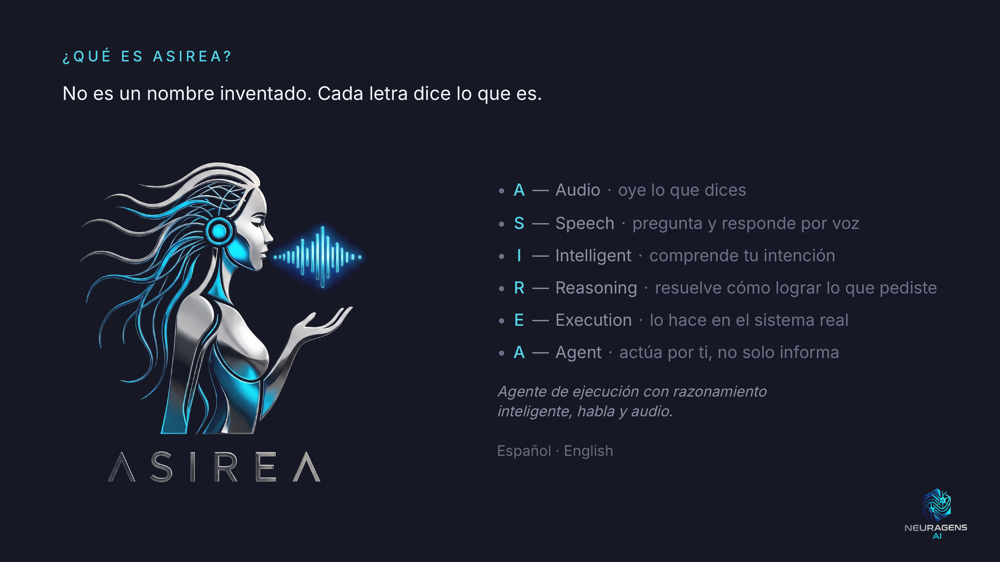

# Hi, I'm Daniel Quintero 👋

Software developer: I build web applications, automations and AI agents that operate real software. I also bring 7+ years of BIM experience on large-scale engineering projects.

## 🎙️ Asirea — AI voice agent that operates software for the user | 100% local

Built for older adults and people with little digital experience: the user speaks, and Asirea operates the software for them through browser automation, in Spanish or English, switching language turn by turn. Everything runs on local hardware, with no cloud APIs: no user data is sent to third-party AI services.

<table>
  <tr>
    <td align="center">
       
      <a href="https://www.youtube.com/watch?v=UaVbT0vyKV4">▶️ Watch demo: medical appointment portal</a>
    </td>
    <td align="center">
       
      <a href="https://www.youtube.com/watch?v=frXOR0_R-gQ">▶️ Watch demo: 3D campus map</a>
    </td>
  </tr>
</table>
Source code is private. Demos in Spanish, with English subtitles.

### How it works

- 👂 **Ear:** my own voice activity detection on top of sounddevice, and speech-to-text with faster-whisper
- 🧠 **Brain:** language understanding and decision logic, running locally with Llama 3 8B via Ollama
- 🗣️ **Voice:** text-to-speech with Piper
- 🤚 **Hands:** Playwright navigates, clicks and fills in the fields
- 🔵 **State orb:** like Siri or Alexa, it shows the user what the agent is doing: listening, thinking or speaking

**Platform design:** one generic core plus interchangeable domain modules. The videos show the same core running two different kinds of software: a demo medical appointment portal and a 3D campus navigation map.

**Design choice:** I wrote the orchestration myself in Python, without LangChain or LangGraph, to keep full control of every step and of latency. No RAG: Asirea doesn't query documents, it executes actions in the software.

**Stack:** Python · Playwright · faster-whisper · Ollama (Llama 3 8B) · Piper · React · Vite · Tailwind CSS · Mapbox GL

## 🛠️ Other projects

**Construcciones Capital** — Corporate website for a client, in production, with a CMS panel where the client edits text, images, gallery and videos without touching code.
 **Stack:** Next.js · TypeScript · Tailwind CSS · Framer Motion · Sanity CMS · Vercel
 [Live website](https://www.construccionescapital.com) · [Code](https://github.com/CauseofDeathLife/construccionescapital-corporate-website)

**AI Recipe Recommender** — Grupo BIOS business challenge. Recommends products from a 75-item catalog and generates recipes with AI on demand, orchestrated in n8n with automatic fallback between models.
 **Stack:** React · Vite · Tailwind CSS · n8n · Gemma 3 27B · GPT-4o · Docker · Vercel
 [Live demo](https://bios-recetas-ia.vercel.app/) · [Code](https://github.com/CauseofDeathLife/ai-recipe-recommender)

**Metro 80 BIM Analytics** — Python ETL over 19,494 telecom elements exported from Revit, with a three-page dashboard of technical and cost indicators.
 **Stack:** Python · Pandas · Plotly · Streamlit
 [Live demo](https://metro80-bim-analytics-dashboard.streamlit.app/) · [Code](https://github.com/CauseofDeathLife/metro80-bim-analytics-dashboard)

**Geo-Reference Automation** — Native Revit add-in that places hundreds of families from Excel coordinates in seconds, a task that takes days by hand.
 **Stack:** C# (.NET) · Revit API · WPF · Excel
 [Video demo](https://www.youtube.com/watch?v=q5j8DmkwhQQ)
